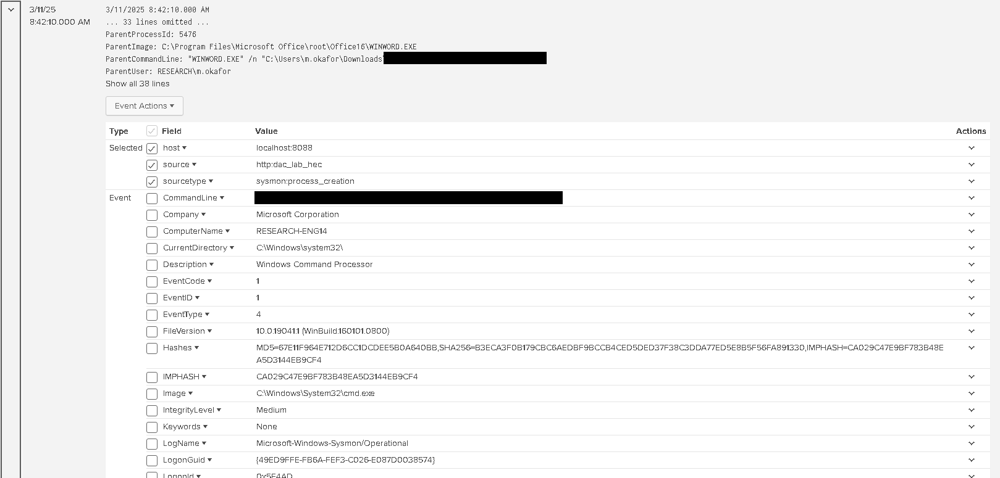
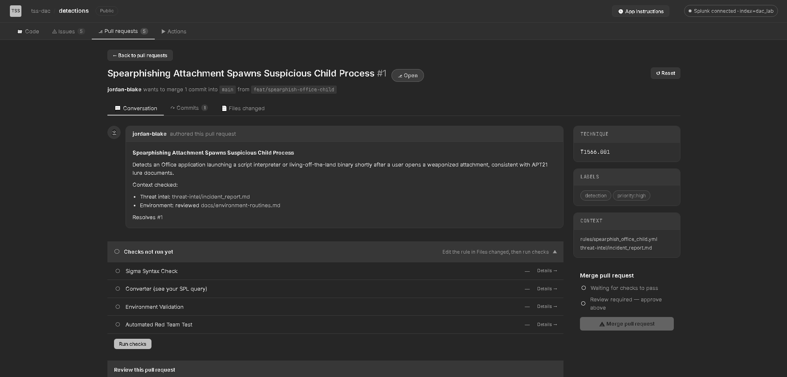
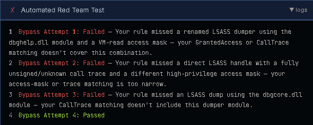
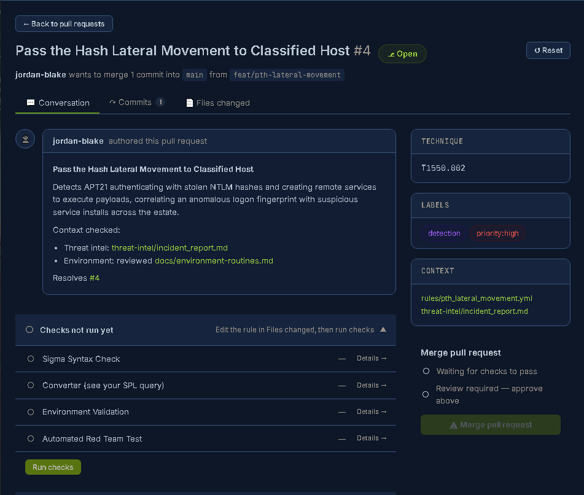
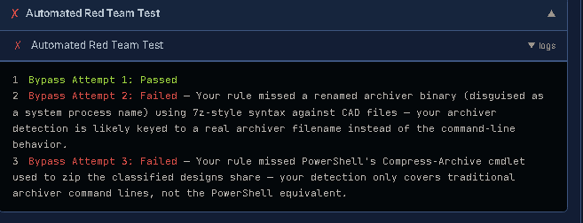

# TryHackMe: DetectMare

**Platform:** TryHackMe | **Path:** SOC Level 2 (Detection Engineering) | **Type:** Detection engineering / Sigma rule tuning

> Spoilers (final rules, benign tool and service names) are hidden in collapsible blocks. Click to reveal. Flags and answer-field values are not included.

## Scenario

A government research institute was breached and not a single alert fired. A CSIRT report describes the full kill chain: a spearphishing attachment, a signed-binary loader, credential theft from LSASS, pass-the-hash onto the classified file servers, and data staged in encrypted archives. As the detection engineer, I review five pull requests in a detection-as-code app, one Sigma rule per step of the intrusion. Each rule needs real tuning against the CSIRT's Splunk logs and is graded on true positives, false positives, false negatives and a set of red-team bypass tests.

## Tools and skills

Sigma rules (process creation, process access, Windows security and system events), Splunk SPL for exploring the logs, MITRE ATT&CK mapping, and reading threat reports for behavior instead of indicators.

## Approach

For every PR I did the same loop:

1. Read the threat report for the technique, not just the sample commands.
2. Read the environment document that lists the institute's legitimate automation, because that is where false positives come from.
3. Query Splunk for the attack events and for the benign events that look similar.
4. Write the rule, run it, read the grader's feedback, and change one thing at a time.



## PR 1: spearphishing attachment spawns a child process

**ATT&CK:** T1566.001, Spearphishing Attachment.



A search for Office documents in the Splunk index found one that stood out, and the command line it launched showed a macro downloading a file with a living-off-the-land binary into the user's temp folder.

**Version 1.** I added the commands from the report to the command-line matches and moved the Office telemetry agent from a selection to a filter. It failed several red-team tests.



**Final version.** Instead of one list of strings, I wrote a selection per Office application (Word, Excel, PowerPoint and Outlook), each paired with the child process behavior it is associated with. The environment document listed a legitimate finance automation that runs a batch file from Excel, which I excluded. The last bypass renamed a malicious payload to the trusted script's name, so a filter on the name or path was not enough. To fix it, I looked up the real script's events in Splunk and saw its parent process command line: Excel opening an internal template. The filter now requires both the script path and that parent command line.

**Takeaway:** allowlist how something was launched, not just what it is called.

## PR 2: signed binary proxy execution

**ATT&CK:** T1218, Signed Binary Proxy Execution.



The report's sample commands used `.dat` files in user-writable folders. Those commands never appeared in the Splunk data, and my first rule, built from them (a path, a list of extensions and a blanket `.dll` exclusion), matched nothing. I lost time looking for events that were not in the logs.

What fixed it was stripping the rule back to one condition and rebuilding:

| Step | Change | TP | FP | FN |
|---|---|---|---|---|
| 1 | Original rule: path, extensions, `.dll` filter, parent filter | 0 | 0 | 1 |
| 2 | Removed the extension list alone, then the `.dll` filter alone | 0 | 0 | 1 |
| 3 | Diagnostic: the proxy binaries only | 1 | 17 | 0 |
| 4 | Proxy binaries plus the user-writable path in the command line | 1 | 10 | 0 |
| 5 | Added filters for the legitimate deployment and CAD tools | 1 | about 1 | 0 |
| 6 | Added a filter for the Windows error reporting activity | 1 | 0 | 0 |

The true positive was a different event from the report's samples: a proxy binary fetching a remote scriptlet, in the same attack chain as PR 1. My blanket `.dll` exclusion had been hiding it, because the event also referenced a DLL. I had added that filter to remove a benign error-reporting event.

**Takeaways:** the report's indicators are not guaranteed to exist in your telemetry, so build from the behavior. A substring filter can hide the real attack. When two conditions each exclude an event, removing one at a time changes nothing, so strip the rule to one condition and add conditions back.

## PR 3: LSASS memory access

**ATT&CK:** T1003.001, LSASS Memory.



The starting rule matched LSASS access through one dumping method. It scored 100% on the true and false positives but failed three bypass tests.


The bypasses used other dumper modules and call traces from unknown memory. The fixes were adding the other debug-help module, matching an unknown frame in the call trace (code that is not backed by a normal module), tightening the error-reporting filter to its full path, and adding a filter for the institute's privileged-access agent. All tests then passed.


**Takeaway:** a rule on one tool's artifact is the easiest to bypass. The unknown call trace catches injected or unsigned callers regardless of the tool.

## PR 4: pass-the-hash lateral movement

**ATT&CK:** T1550.002, Pass the Hash.


A network logon with NTLM and a key length of zero is the fingerprint. On its own it scored 1 true positive, 7 false positives and 1 false negative, because other benign NTLM logons share it.


My first idea was a correlation rule: a logon followed by a remote service installation on the same host. The grader would not score it, because it evaluates single events and does not run correlations. So I went back to an atomic rule that matches either event, with filters for the legitimate logons (a legacy workstation and a service account) in the environment document. One variant using a service that launches a command interpreter still failed.


Adding a selection for that service pattern fixed it, and the PR passed.

**Takeaway:** the right detection here is a correlation, because either event alone is noisy. The grader only scores single events, so the submitted rule is a compromise. I would build the correlation in a real SIEM.

## PR 5: data staged and archived

**ATT&CK:** T1560.001, Archive via Utility.


I started with the two archivers' image names and a filter for the backup routine, then added the CAD file extensions. That passed the environment check but failed the bypass tests, which used a renamed archiver and PowerShell.


The final rule no longer depends on the archiver's name. It requires a CAD extension in the command line plus either an archive file name or PowerShell's archive command, and it excludes the legitimate backup routine.

**Takeaway:** if a tool can be renamed, don't make the rule depend on its name.

## Detection takeaways

- Build from behavior, not from the report's sample commands.
- Read the environment document before writing any filter, and look at the benign events in Splunk.
- Filters should tie several attributes together, such as parent, full path and command line. A name alone can be copied by an attacker.
- Change one thing at a time and record the counts after every run.

## What I'd do differently

- I built PR 2 from the report's examples and spent about an hour hunting for events that were not in the logs. I would look at the real telemetry first.
- I added a blanket `.dll` exclusion that hid the true positive. I would filter on specific attributes.
- I didn't record the grader's counts after each run, so most of my tuning history is gone. I would keep a small table from the first run.
- I spent time on a correlation rule before checking whether the grader could score one.

## Limitations

- Several filters trust names, such as the parent process in PR 2 and the service account in PR 5. Both are weak against an attacker who learns them.
- PR 4's service selections are hard-coded to this incident's indicators, so that part detects this intrusion, not the technique.
- PR 3 does not use the access mask, and I did not add the second debug module to the final rule.
- PR 1 matches `%TEMP%` literally, but command lines usually show the expanded path.
- All results are from the room's grader and its simulated data, not a production environment.

## MITRE ATT&CK mapping

- T1566.001, Spearphishing Attachment (PR 1)
- T1218, Signed Binary Proxy Execution (PR 2)
- T1003.001, LSASS Memory (PR 3)
- T1550.002, Pass the Hash (PR 4)
- T1560.001, Archive via Utility (PR 5)

## The rules

These are the final rules as I submitted them. The room supplied the rule skeletons, and the detection logic and tuning are mine. They are the solutions, so they are hidden.

<details>
<summary>PR 1: spearphishing attachment</summary>

```yaml
title: Spearphishing Attachment Spawns Suspicious Child Process
id: 3f9a2b10-1e44-4a2b-9b0a-1a2b3c4d5e06
status: experimental
description: Detects an Office application launching a script interpreter or living-off-the-land binary, consistent with APT21 lure documents.
author: abdelmoize-baba
logsource:
  product: windows
  category: process_creation
detection:
  selection_word:
    ParentImage|endswith: '\WINWORD.EXE'
    CommandLine|contains:
      - 'certutil'
      - '%TEMP%'
      - '.bat'
  selection_excel:
    ParentImage|endswith: '\excel.exe'
    CommandLine|contains:
      - 'powershell.exe'
      - 'pwsh.exe'
      - '.bat'
  selection_powerpnt:
    ParentImage|endswith: '\powerpnt.exe'
    CommandLine|contains: 'regsvr32.exe'
  selection_outlook:
    ParentImage|endswith:
      - '\outlook.exe'
      - '\olk.exe'
    CommandLine|contains: 'mshta.exe'
  filter_office_telemetry:
    Image|endswith: '\officetelemetryagent.exe'
  filter_finance_automation:
    CommandLine|contains: 'C:\ProgramData\ResearchIT\Automation\monthend_report.bat'
    ParentCommandLine|contains: '"EXCEL.EXE" "C:\Finance\MonthEnd_Template.xlsm'
  condition: 1 of selection_* and not 1 of filter_*
```
</details>

<details>
<summary>PR 2: signed binary proxy execution</summary>

```yaml
title: Signed Binary Proxy Execution of NetTraveler Dropper
id: 3f9a2b10-1e44-4a2b-9b0a-1a2b3c4d5e07
status: experimental
description: Detects APT21 using signed Windows binaries to proxy execute the NetTraveler loader from a non-standard path.
author: abdelmoize-baba
logsource:
  product: windows
  category: process_creation
detection:
  selection:
    Image|endswith:
      - '\rundll32.exe'
      - '\regsvr32.exe'
    CommandLine|contains:
      - '\ProgramData\'
      - '\AppData\'
  filter_utilities:
    ParentImage|endswith:
      - '\researchdeploy.exe'
      - '\sldworks.exe'
  filter_wer:
    ParentImage: 'C:\Windows\System32\svchost.exe'
    CommandLine|contains: 'C:\ProgramData\Microsoft\Windows\WER\report.dll'
  condition: selection and not 1 of filter_*
```
</details>

<details>
<summary>PR 3: LSASS memory access</summary>

```yaml
title: LSASS Memory Access for Credential Theft
id: 3f9a2b10-1e44-4a2b-9b0a-1a2b3c4d5e09
status: experimental
description: Detects suspicious handle access to LSASS consistent with APT21 credential dumping.
author: abdelmoize-baba
logsource:
  product: windows
  category: process_access
detection:
  target:
    TargetImage|endswith: '\lsass.exe'
  selection:
    CallTrace|contains:
      - '\comsvcs.dll'
      - '\dbghelp.dll'
      - 'UNKNOWN'
  filter_wer:
    SourceImage: 'C:\Windows\System32\WerFault.exe'
  filter_vault_agent:
    SourceImage: 'C:\Program Files\ResearchPAM\vaultagent.exe'
  condition: target and selection and not 1 of filter_*
```
</details>

<details>
<summary>PR 4: pass-the-hash lateral movement</summary>

```yaml
title: Pass the Hash Lateral Movement to Classified Host
id: 3f9a2b10-1e44-4a2b-9b0a-1a2b3c4d5e0a
status: experimental
description: Detects APT21 NTLM pass-the-hash logon followed by remote service creation.
author: abdelmoize-baba
logsource:
  product: windows
detection:
  selection_passthehash:
    EventID: 4624
    LogonType: 3
    KeyLength: 0
    AuthenticationPackageName: 'NTLM'
  filter_legit_logon:
    - WorkstationName|contains: 'MES-LEGACY'
    - TargetUserName: 'svc_cluster'
  selection_service:
    EventID: 7045
    ServiceName: 'WinHelpSvc'
    ServiceFileName|contains: 'C:\ProgramData\Intel\nt.dat'
  selection_service_pwsh:
    EventID: 7045
    ServiceFileName|contains:
      - 'cmd.exe'
      - 'powershell -e'
  condition: (selection_passthehash and not filter_legit_logon) or 1 of selection_service*
```

The ungraded correlation attempt, kept for reference (though not finished). The grader does not evaluate correlation rules:

```yaml
title: NTLM Pass-the-Hash Network Logon
id: afb204a8-c65e-44af-b358-dd944dc5d786
status: experimental
description: Base rule detecting network logons using NTLM with KeyLength 0, indicative of Pass-the-Hash activity.
logsource:
  product: windows
  service: security
detection:
  selection:
    EventID: 4624
    LogonType: 3
    KeyLength: 0
    AuthenticationPackageName: 'NTLM'
  condition: selection
level: low
---
title: New Windows Service Installed
id: 28c3423d-873d-428e-b165-36e1a0e933cb
status: experimental
description: Base rule detecting the installation of a new service on a Windows host.
logsource:
  product: windows
  service: system
detection:
  selection:
    EventID: 7045
    ServiceName: 'WinHelpSvc'
    ServiceFileName: 'C:\ProgramData\Intel\nt.dat'
  condition: selection
level: low
---
title: Pass the Hash Lateral Movement to Classified Host
id: 3f9a2b10-1e44-4a2b-9b0a-1a2b3c4d5e0a
status: experimental
description: Detects APT21 NTLM pass-the-hash logon followed by remote service creation.
author: abdelmoize-baba
correlation:
  type: temporal
  rules:
    - afb204a8-c65e-44af-b358-dd944dc5d786
    - 28c3423d-873d-428e-b165-36e1a0e933cb
  group-by:
    - ComputerName
  timespan: 5m
  condition:
    gte: 2
level: high

```
</details>

<details>
<summary>PR 5: data staged and archived</summary>

```yaml
title: Weapons Program Data Staged and Archived for Exfiltration
id: 3f9a2b10-1e44-4a2b-9b0a-1a2b3c4d5e0b
status: experimental
description: Detects APT21 compressing classified design documents into a password-protected archive prior to exfiltration.
author: abdelmoize-baba
logsource:
  product: windows
  category: process_creation
detection:
  selection_s_image:
    Image|endswith:
      - '\7z.exe'
      - '\rar.exe'
  selection_extensions:
    CommandLine|contains:
      - '.sldprt'
      - '.catpart'
      - '.dwg'
  selection_s_artifacts:
    CommandLine|contains:
      - '.7z'
      - '.rar'
      - '.zip'
  selection_s_powershell:
    Image|endswith: '\powershell.exe'
    CommandLine|contains: 'Compress-Archive'
  filter:
    - CommandLine|contains: 'SW_AutoBackup'
    - User|contains: 'svc_backup'
  condition: selection_extensions and (1 of selection_s*) and not filter
```
</details>
