# TryHackMe: Fixit

**Platform:** TryHackMe | **Path:** SOC Level 2 (Advanced Splunk) | **Type:** Splunk data onboarding and analysis

> Spoilers (paths, settings, regex) are hidden in collapsible blocks. Click to reveal. Answer-field values are not included.

## Summary

The scenario is the final assessment for a SOC Level 2 role at an MSSP: a Splunk instance receives network logs from an unknown source, but the data arrives unusable. Before any analysis, I had to repair the ingestion: fix the event boundaries, extract custom fields, and then use the cleaned-up data to investigate what was happening on the network.

**Skills shown:** Splunk configuration (`inputs.conf`, `props.conf`, `transforms.conf`, `fields.conf`), event line breaking, regex field extraction, SPL analysis.

## Phase 1: Fixing event boundaries

Splunk was ingesting the raw data, but it couldn't tell where one event ended and the next began, so the events were unusable.

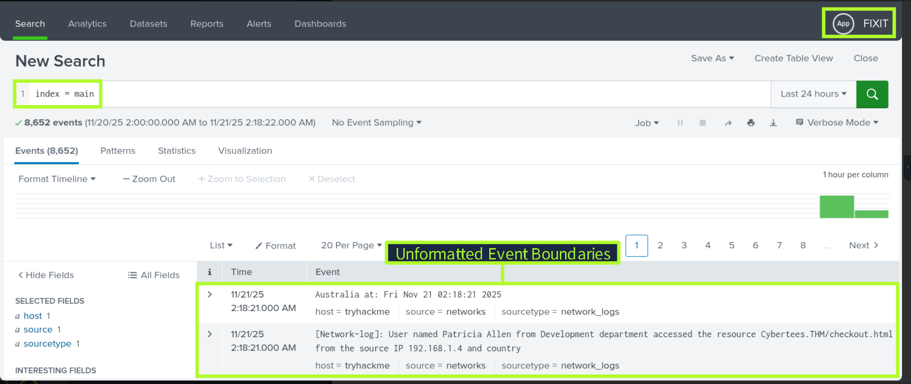

I started by finding the Fixit app in Splunk's apps directory and reading its `inputs.conf` in the `default` directory, which holds the path of the script that generates the network logs.

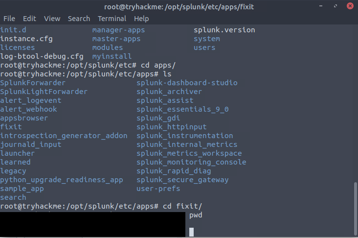
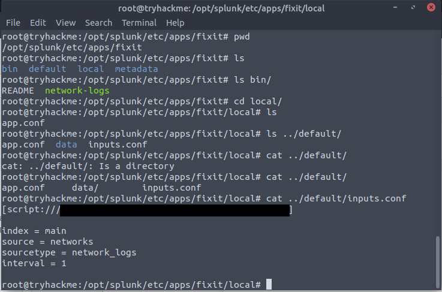

Every log line starts with `[Network-log]`, so I used that as the anchor. By telling Splunk to break lines before each occurrence, every event runs from one `[Network-log]` marker to the next, and each is treated as a single event. The relevant documentation is [Configure event line breaking](https://help.splunk.com/en/splunk-cloud-platform/get-started/get-data-in/10.2.2510/configure-event-processing/configure-event-line-breaking).

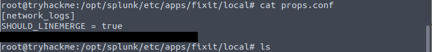

Spoiler: values

- Apps directory: `/opt/splunk/etc/apps/`
- Start-of-event regex: `^\[Network-log\]` (escaped brackets, anchored to the start of the line)
- Setting used: `BREAK_ONLY_BEFORE`

## Phase 2: Extracting custom fields

The next step was extracting meaningful fields from the event text: username, department, domain, URI, source IP and country. The sample logs follow a fixed sentence pattern ("User named ... from ... department accessed the resource ... from the source IP ... and country ... at ..."), which made a regex extraction practical.

Three configuration files work together:
1. **`transforms.conf`:** a stanza with the extraction regex and a `FORMAT` that names each capture group as a field.
2. **`props.conf`:** a stanza linking the sourcetype to that transform.
3. **`fields.conf`:** declares the extracted fields as indexed (`INDEXED = true`), because this was an index-time extraction: the fields are stored with the events at ingestion.

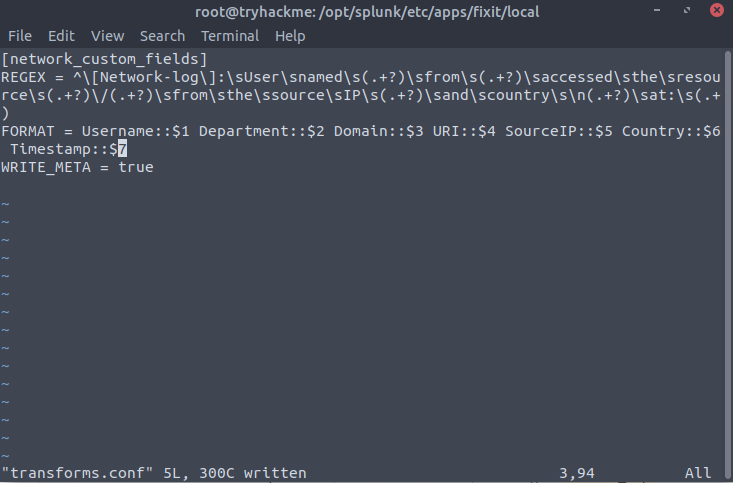
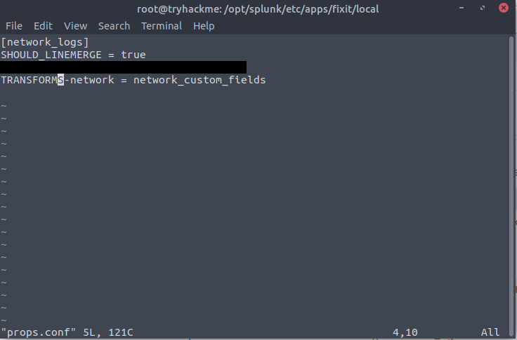
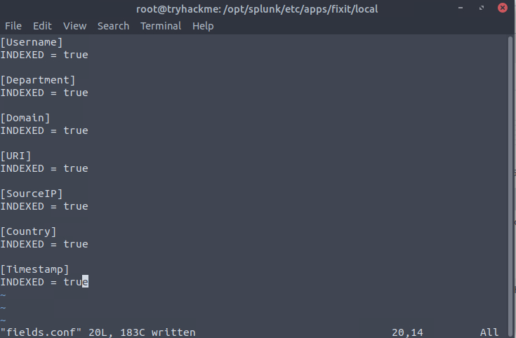

After restarting Splunk, I checked that the fields appeared in the sidebar.

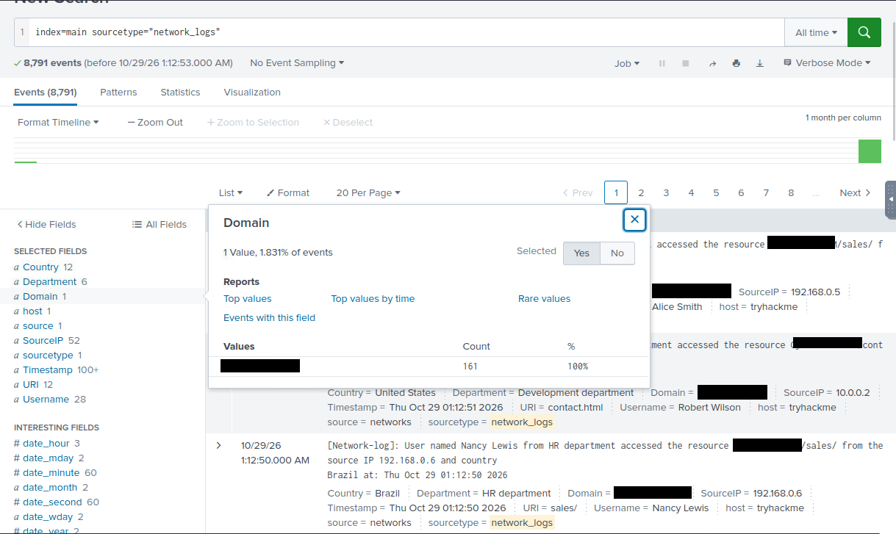

I then counted the distinct values of the username and URI fields.

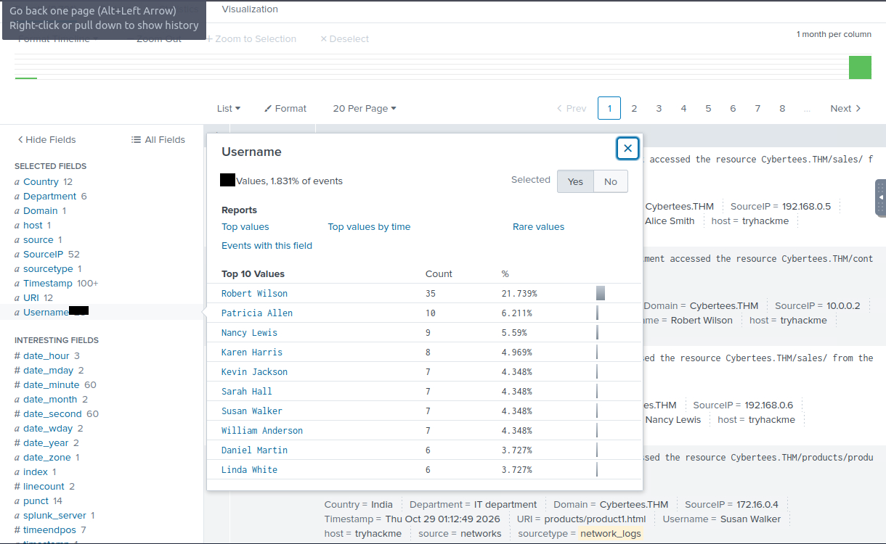
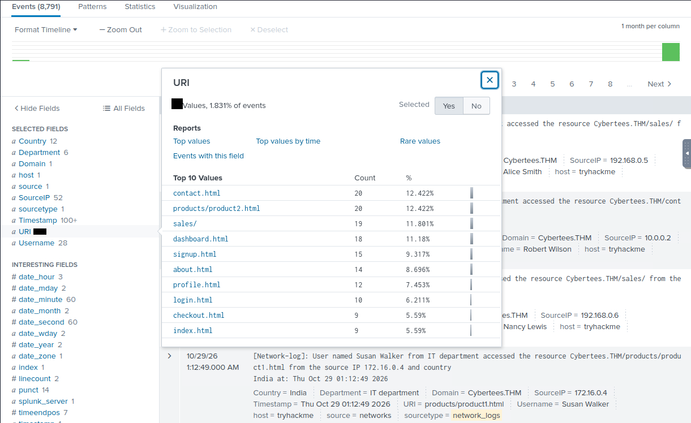

## Phase 3: Analysing the data

With the data parsed, I answered several questions about the traffic. The investigation itself was short, since the room's focus is the configuration work and the payoff of having usable fields.

- **Product pages:** counted the distinct `/products` URIs.
- **URI without a file extension:** the odd one out in the URI list.
- **Most active user:** a count of events by user.
- **IP ranges:** a table of source IPs showed how many distinct ranges were present, all of them private address space.
- **PDF access:** a search for `*.pdf` isolated a single user, visible in the selected fields.

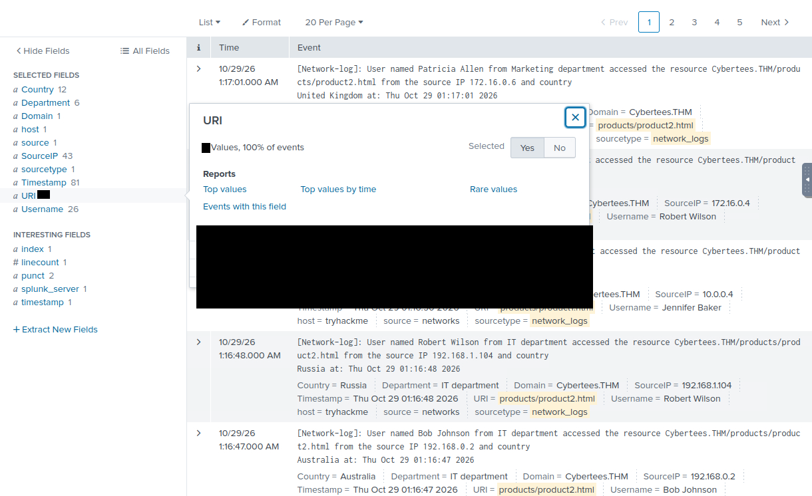
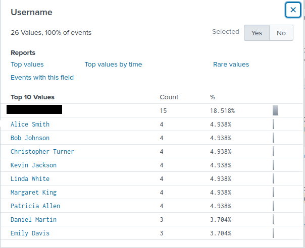

## What I learned

- Data has to be fixed *before* it can be analysed. A broken event boundary hides everything downstream.
- Splunk's parsing configuration chains across files: the regex lives in `transforms.conf`, `props.conf` links it to the sourcetype, and `fields.conf` declares the fields.
- Restarting and verifying after each change catches configuration mistakes early.
