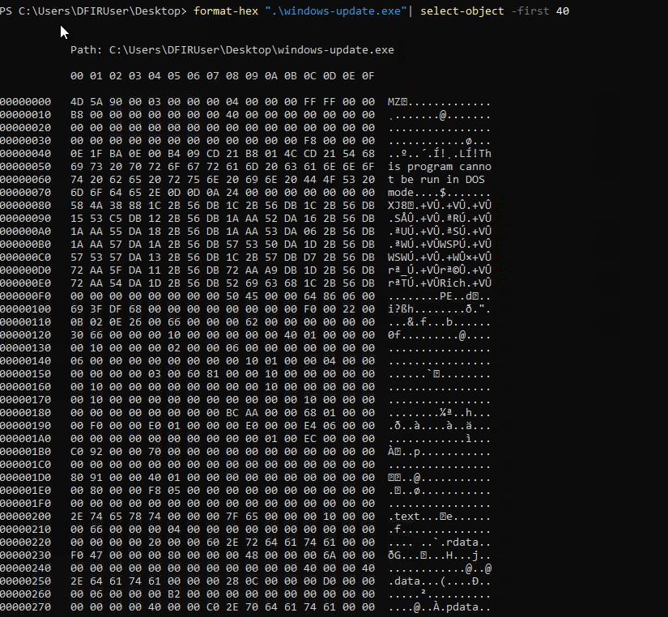
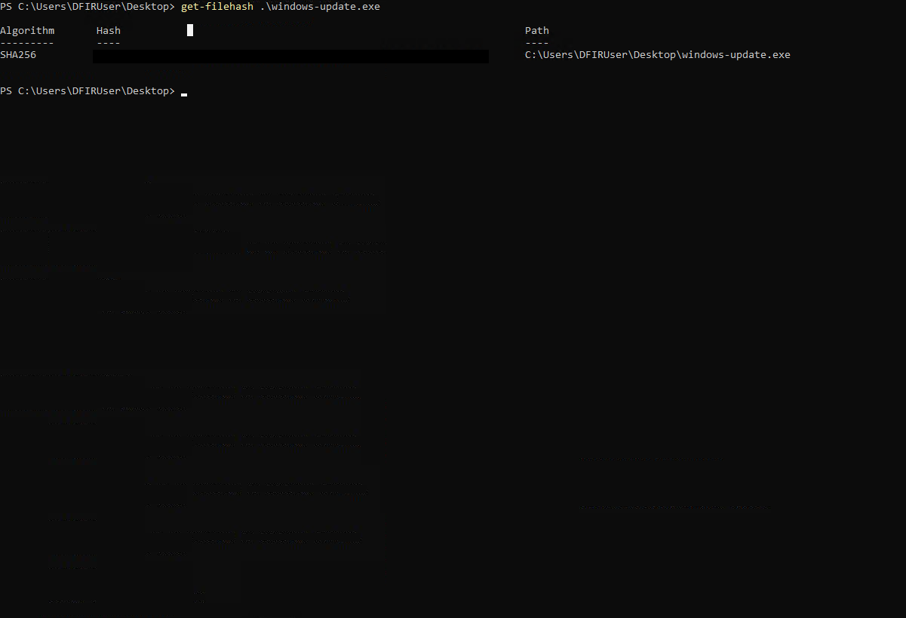
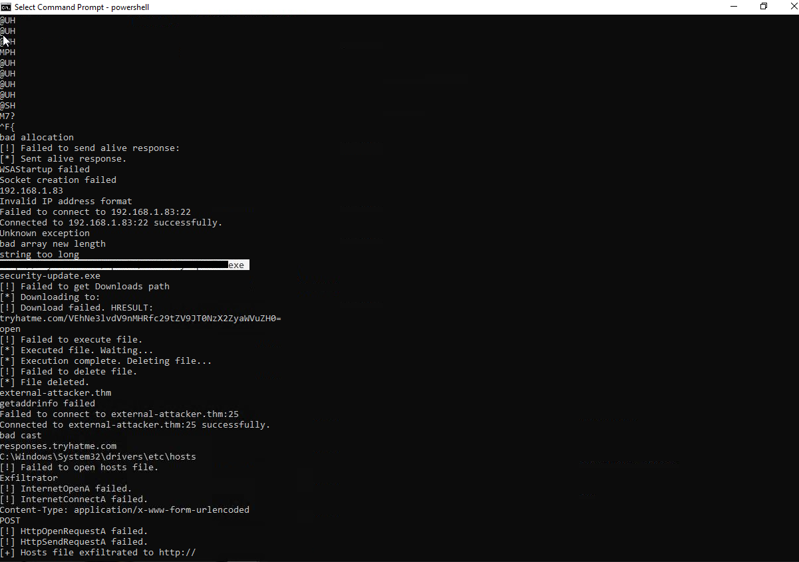
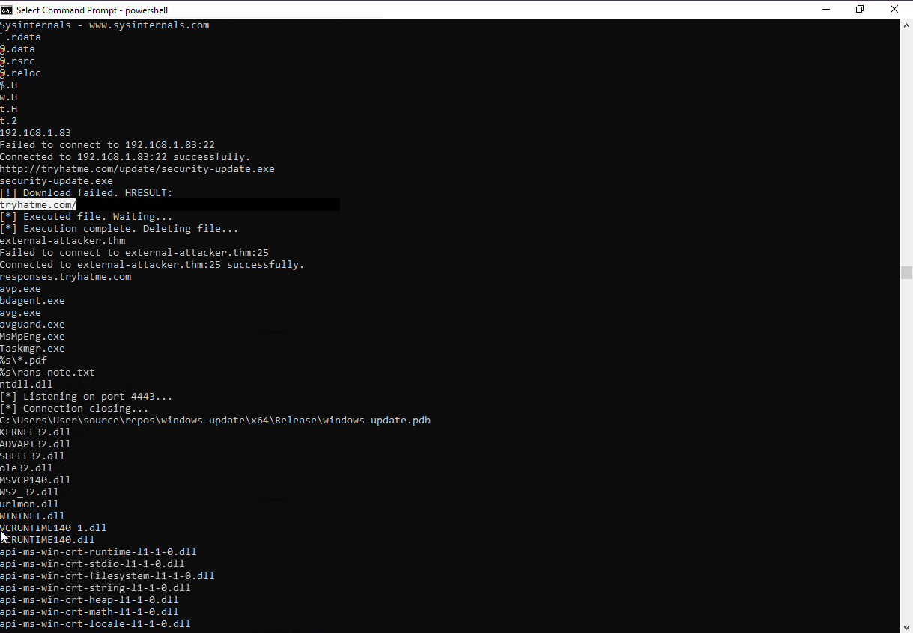
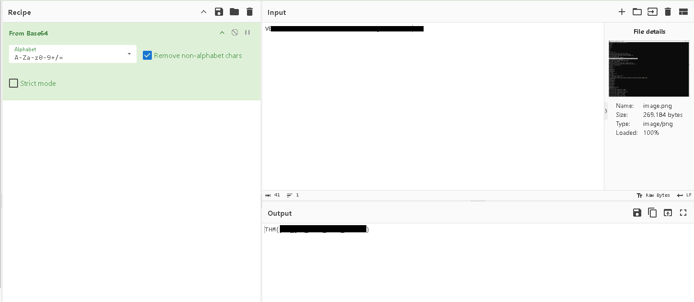

# TryHackMe: ShadowTrace

**Platform:** TryHackMe | **Path:** SOC Level 1 | **Type:** Static file triage

> Spoilers (domain, decoded flag) are hidden in a collapsible block. Click to reveal. Flags are not included.

## Summary

Night shift, one analyst on duty, and a manager calls about a suspicious file found on a user's machine: `windows-update.exe`, on the Desktop of a DFIR workstation. It doesn't look like a normal company updater. My task was to identify the file, collect indicators of compromise (IOCs), and work out what it does. This write-up covers the **static analysis** of the binary, using only built-in PowerShell commands and a couple of small tools.

**Skills shown:** PE header reading, file hashing, string extraction, IOC identification, decoding an encoded payload.

*This room covers static triage of a single file, not a full malware analysis. I did not run the file or cover the EDR alert correlation described in the scenario.*

## Tools

- PowerShell (`Format-Hex`, `Get-FileHash`, `Select-String`)
- `strings` (Sysinternals)
- CyberChef
- PEStudio was available on the machine, but I used the command line instead.

## 1. Architecture

To check the architecture without a GUI tool, I dumped the first bytes of the file:

```powershell
Format-Hex "windows-update.exe" | Select-Object -First 10
```

How to read the output:
1. The first two bytes should be `4D 5A` ("MZ"), confirming a Windows executable.
2. Scan for `50 45 00 00` (the "PE" signature).
3. The two bytes right after it are the machine type, stored in little-endian order: `4C 01` is 32-bit x86, `64 86` is 64-bit x64, and `64 AA` is ARM64.



## 2. Hash

`Get-FileHash` defaults to SHA-256:

```powershell
Get-FileHash "windows-update.exe"
```



## 3. Strings and IOCs

Running `strings` on the file revealed several readable artefacts. The first useful finding was a URL in the file, which is a strong IOC candidate.



To narrow down the output to domain-like strings, I filtered for lines containing dots:

```powershell
strings "windows-update.exe" | Select-String ".+\..+"
```

In a real case, any domain found this way would need a reputation check before being treated as malicious. Here, the URL pointed to an executable named like a security update, hosted on an unfamiliar domain.

## 4. Encoded payload

A second URL on the same domain contained what looked like an encoded payload.



I decoded it in CyberChef, which gave the flag.



<details>
<summary>Spoiler: values</summary>

- URL found in the file (defanged): `hxxp://tryhatme[.]com/update/security-update.exe`
- Domain IOC: `tryhatme[.]com`
- SHA-256: `b2a88de3e3bcfae4a4b38fa36e884c586b5cb2c2c283e71fba59efdb9ea64bfc`
- The decoded flag is not included.

</details>

## IOC summary

| Type | Value |
|---|---|
| File name | `windows-update.exe` |
| SHA-256 | In the spoiler block above |
| Domain / URLs | In the spoiler block above (defanged) |

## Detection takeaways

- A file posing as a Windows updater, outside the normal update mechanisms, should be treated as suspicious until proven otherwise.
- Embedded URLs and domains in a binary are quick IOCs. Once found, search DNS, proxy and firewall logs for other hosts contacting them.
- URLs with long encoded strings often carry configuration or payloads. Decoding them can reveal what the file does.

## Follow-up in a real investigation

These steps were not part of the room, but I'd do them in a real case:
- Check the hash's reputation on VirusTotal.
- Inspect imports and sections in PEStudio.
- Hunt for the domain across logs to find other affected hosts.
